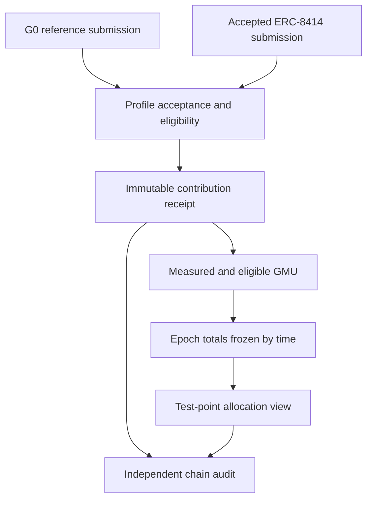

# PoUW Architecture

Document alignment dated **2026-11-24** (design revision v0.1.4). Implemented baseline: the kernel
of **v0.1.2 R1**, as released in v0.1.3 with the tooling of round R2. v0.1.3 changed no contract
(`decisions.md` A31).
This document aligns the architecture with the owner-approved economic development stages and
intelligence-production direction. It does not change a release version, contract, ABI,
deployment or the approved R2 scope. References are to `decisions.md`: A1-A39 and P1-P41 belong
to the baseline, A40-A54 record this alignment, and P42-P53 are the executor's proposals for
carrying it out. A55-A64 record the review of design revision v0.1.4 and A65-A67 that of v0.1.5;
P54-P60 are the executor's proposals for carrying the two reviews out (design revisions v0.1.5
and v0.1.6). In this document they change the pointers to the plans and nothing else. On the
questions the plans raise (Q17 to Q29) the owner adopted the advisor's recommendations on
2026-11-24 (A70). On 2026-11-25 the owner ruled on Q13 to Q16 (A73 to A79): the next version
of the ledger is built on those rulings as a second set of contracts beside the kernel
(`contracts/v2/`; `ledger-v2.md`), on a local network and not deployed, and from release 0.1.4
the reference client reads one block for an audit. The interfaces of that version were frozen
on the same day (A81). Section 3.1 lists both; nothing else of this document changes with
them. Sections labelled **future design** describe
requirements for later work, not features available in R1. The three stages and five subdivisions
below refine and replace A17's older economic-stage numbering. A17's approved compatibility with
operator funding, agent procurement and self-operated hardware remains in force; those operating
forms can coexist.

## 1. Purpose and position

Proof of Useful Work (PoUW) connects the production, use, verification and compensation of useful
AI work on an EVM chain. Its long-term purpose is a sustainable intelligence economy in which
independent suppliers and autonomous cells can provide services, purchase their inputs, maintain
themselves and settle the resulting obligations. Useful work happens off chain. Its evidence,
acceptance and contribution are recorded under explicit rules. Independent readers can recompute
the public ledger's accounting; verification of a delivery additionally depends on the evidence
and access conditions of its work profile (A1, A7).

PoUW is an economic-layer protocol. It changes nothing in block production, derivation, fault
proofs or settlement of the L2 (A1, A10). Finchain is the first reference chain, and the protocol
interfaces remain applicable to other compatible EVM deployments (A13).

### 1.1 The first production commodity and the implemented baseline

LLM token generation is the first production commodity targeted by the economic roadmap. A
supplier sells an inference service under a stated model and service specification. The protocol
must distinguish its raw token usage, its qualified intelligent delivery and its economic value.
Section 6 develops those three records. Producing more tokens alone establishes neither more
useful work nor a larger reward.

R1 supplies the contribution and allocation foundation. It implements deterministic `g0.ref`,
settled ERC-8414 `g1.tender` receipts, GMU and non-redeemable epoch allocation tables. It does not
implement model serving, inference usage verification, SIG, agent procurement or payment rails.
Its G0 receipt demonstrates presence and a conforming submission, not a quantity of computation
or intelligence production (A19).

| Architectural concern | Implemented in v0.1.2 R1 | Future design |
| --- | --- | --- |
| Work and acceptance | `AuditV1` output and an accepted ERC-8414 submission | Qualified inference, agent outcomes and independently verifiable support work |
| Contribution | Versioned profile rules, measured GMU and GMU eligible for the simulated subsidy | Additional profiles with evidence appropriate to each contribution |
| Production capability | No capability rating | SIG calibration for a specified service class, with provenance and validity conditions |
| Delivery metering | No inference token meter | Usage records and qualified delivery quantities under a versioned standard |
| Economic accounting | ERC-8414 service settlement remains outside the PoUW ledger | Procurement costs, customer revenue, subsidy and payment reconciliation |
| Reward | A deterministic test-point allocation view | Separately approved compensation and Tokenomics modules |

The R1 flow remains small and independently usable.

### 1.2 Economic development stages

These owner-approved stages describe changes in funding, procurement and intelligence supply
across the network. They are independent of engineering milestones P1-P4 and implementation
rounds R0-R4. Completing a round does not certify that an economic stage has been reached.
Earlier operating forms remain available as later ones develop. No dates, adoption percentages,
revenue thresholds or mandatory hardware transition are introduced by this alignment.

| Economic stage | Funding and procurement | Intelligence supply | Meaning of the transition |
| --- | --- | --- | --- |
| Stage 1 early: **Startup** | A person pays model bills in fiat and continues manual funding and renewal | Primarily external model services | A non-independent economy establishes working supply, token metering, qualified delivery and value records |
| Stage 1 middle: **Development** | A Holder funds an agent's crypto wallet or an authorized funded fiat/API payment account. The agent purchases and renews services within its delegated budget | Primarily external model services, alongside the Startup form | A semi-independent economy automates procurement and payment while funding can still depend on people |
| Stage 1 late: **Pre-expansion** | Development-stage procurement predominates; remaining Startup operations stay compatible | Most supply still uses external models. A smaller set of operators begins to run its own GPUs and models | Autonomy over data and service calls begins to extend into control of hardware supply |
| Stage 2: **Expansion** | Multiple procurement and funding forms coexist under compatible accounting | Independent suppliers scale self-operated GPUs and models, and their deliveries are accepted under a common standard. External APIs remain usable | The basic PoUW production ecosystem matures through interoperable, qualified supply |
| Stage 3: **Maturity** | More production, procurement, routing, budgets and maintenance are handled autonomously within explicit authority | Diverse AI services, self-maintaining cells and a mixture of supply arrangements | Autonomous operation, self-repair and controlled replication support a broader AI economy. Foundational token production and earlier participation forms continue |

Stage 1 must establish how token usage becomes qualified delivery and how delivery relates to
actual economic value. Its acceptance cannot be reduced to deploying a point ledger. Conversely,
that requirement does not enlarge the already approved R1 or R2 engineering scope. Production
metering and procurement receive their own subsequent specification and acceptance evidence.

### 1.3 Three independent operating dimensions

Each future node or service report must describe these dimensions separately. They are descriptive
records, not new R1 contract fields or admission rules.

| Dimension | What it answers | Evidence required for a later claim |
| --- | --- | --- |
| Payment autonomy | Who chooses, authorizes, executes and renews a purchase? | Delegated policy, budget, purchase and renewal records |
| Operating self-sufficiency | Do earned external service revenues cover the operation over a stated period? | Reconciled revenue, supplier costs, operating costs and separate funding/subsidy records |
| Supply control | Who operates the inference runtime, model and underlying compute? | Disclosed provider path and evidence appropriate to the claimed level of control |

An automatically renewed API account can still depend on fresh Holder funding. A self-operated
GPU can still be loss-making or manually managed. A profitable service may buy all its inference
from other suppliers. These combinations are valid. The protocol must not collapse them into one
claim of autonomy or self-sufficiency.

## 2. Actors

### 2.1 Actors in the implemented protocol

| Actor | What it does | R1 and reference participation |
| --- | --- | --- |
| Worker | Submits G0 from an EVM address - a key, or a contract account - or fulfills a G1 tender | Local test workers. On Sepolia: two wallets an operator holds in round R2a; the Cell Accounts of the OG and cell-b in round R2b; then a third party (A37, A39) |
| Demander | Issues an ERC-8414 tender, arranges acceptance and confirms the settled submission to the ledger | The tender owner calls the adapter; subsidy eligibility also requires admission |
| Module | Supplies the deterministic G0 function or reports a G1 settlement | `AuditV1`, `TenderAdapter8414` |
| Steward | Registers future profile and parameter versions, admits addresses, declares operators and can pause recording | Cannot edit a recorded receipt, status, total or allocation |
| Auditor | Recomputes an ended epoch from the chain | Anyone using `pouw audit` or an independent implementation |
| Anyone | Captures an epoch seed on first use and can write an ended epoch's close record | Neither operation supplies allocation figures |
| Chain | Orders and stores receipts, policy and totals | Finchain Sepolia first (A15) |

There is no paid verifier or keeper role in R1. Acceptance is a contract call or ERC-8414's own
settlement, and an epoch closes by time. Running a chain verification node earns no PoUW reward
by itself (A8).

### 2.2 Production and economic roles: future design

| Role | Responsibility | Required separation |
| --- | --- | --- |
| Model supplier | Offers a model service under a declared specification | A supplier using an upstream API discloses that source; offering an endpoint is not proof of self-operated GPUs |
| Compute operator | Operates or leases compute and serves model execution | Hardware control, model execution and service delivery need evidence appropriate to each claim |
| Agent service provider | Uses models and tools to fulfill a customer's outcome | Buying inference and delivering an application outcome are separately attributable activities |
| Procurement agent | Chooses, buys and renews inputs within an authorized budget | Spending authority, funding availability and successful payment are distinct facts |
| Router | Matches requests to qualified suppliers and may fail over among them | Selection fees and routing contribution must be attributable without counting the underlying delivery twice |
| Delivery verifier | Checks the acceptance evidence defined by a profile | Verification of its own or a related party's work needs explicit treatment; no score for merely agreeing with a published result |
| Customer or Holder | Purchases a service or supplies operating capital | Customer revenue and Holder funding are different economic sources |
| Payment service | Executes and reconciles fiat, native-asset or supported token payments | A signed authorization or a funded promise does not prove an executed payment |

One entity can perform several roles, but records must preserve which role it performed, for
whom, and with what declared relationship. Separate addresses alone do not establish independence.

### 2.3 Standard complete AI Node and open participation

The standard complete Finchain AI Node combines four capabilities:

- Independent L2 state verification through a chain node.
- Available intelligent-service supply, with its model/provider path and service limits declared.
- FOGA cellular capabilities for authorized action, maintenance, self-repair, recovery and
  replication through code.
- A PoUW interface for work, evidence, contribution and audit.

This is the direction of the complete operating form, not a claim that every existing node already
has all four capabilities. Cellular replication creates a separately configured instance with its
own authority, state and budget boundaries; it does not imply copying private keys or granting
the replica unlimited funds.

Chain verification does not grant sequencing or block-production authority. A worker can provide
inference through external services, rented compute or self-operated hardware. A GPU is not an
admission requirement. The three participation forms remain available (A8, A16):

| Form | Participation |
| --- | --- |
| Finchain AI Node | The standard complete operating form, combining chain verification, intelligent services, cellular autonomy and PoUW |
| Finchain Work Node | A FOGA cell, another agent or a reference-client worker uses RPC and PoUW without running a chain node |
| Finchain Chain Node | Independent EVM/L2 verification without providing AI work |

Colocation is possible but does not merge the trust boundaries. Chain administration, worker
operation, procurement permissions and delegated smart-account permissions remain distinct. L1
administration and sequencer keys must not become model-payment or worker keys through this
integration.

## 3. Modules as built

### 3.1 R1 modules: the kernel of v0.1.2, with the tooling added in v0.1.3

| Module | Role | Covers, of the R1 scope (A30) |
| --- | --- | --- |
| `GenesisPolicy` | Immutable genesis time and epoch duration; versioned profiles and parameters; future-effective admissions and operator declarations; pause; two-step stewardship | Profile and Policy |
| `GenesisLedger` | Receipts and statuses; epoch seeds; measured and subsidized GMU and totals; G1 subsidy rules; allocation view; close record | Work Receipts, Epoch Rewards |
| `AuditV1` | The first G0 function: the audit subject of the previous epoch (`IG0Function`) | `g0.ref` |
| `PrevBlockSeedSource`, `L1BlockSeedSource` | Seed material from the previous block or the OP Stack L1 block reference (`ISeedSource`) | Deployment-selected seed source |
| `TenderAdapter8414` | Reads one ERC-8414 contract and reports an accepted submission; only the tender owner can call it | ERC-8414 adapter |
| `client/pouw.js`, `client/lib/` | `status`, `work`, `bridge`, `seal`, `audit` and, since v0.1.3, `verify`; as a key or through a contract account; through JSON-RPC | Reference client and audit |
| `build/`, `scripts/` | Since v0.1.3: the builds a deployment is made from; the deployment from a configuration file; keys; an operator's round; the identity check; the rehearsal. Tooling of round R2, none of it part of the protocol | - |
| `client/lib/canonical.js`, `scripts/report-hash.py` | Since release 0.1.4: the one byte form of a record and its two hashes; an audit and a check of a deployment read one block (`genesis-mining-mvp.md` 12) | Reference client and audit |
| `contracts/v2/`: `GenesisPolicyV2`, `GenesisLedgerV2`, `TenderAdapter8414V2`, `IParticipantGuard`, and the optional `guards/FogaCellGuard` | Ledger v2, beside the kernel and not a change of it: a bounded delegation checked at each use, with a guard on the consumer's side; the cap on a declared operator's aggregate; work facts apart from receipts; the receipt fields of the production line. Built and tested on a local network; interfaces frozen (A81; `contracts/v2/interfaces.frozen.json`); compiled behind a boundary of its own by solc 0.8.39, with its builds and their record under `build/v2/` (A82; `ledger-v2.md` 1); not deployed | the next version of the ledger (A35, A74, A75) |
| `scripts/sign-permit.js`, `client/lib/permit.js`, `client/lib/ledger2.js` | The three signed statements of ledger v2, signed off line from a key file, and the encodings and the allocation of ledger v2 off chain | - |
| `client/lib/audit2.js`, `client/lib/report2.js` | Since release 0.1.7, corrected in 0.1.8: the audit of an epoch of ledger v2 at one block, and its record (`ledger-v2.md` 13.1). A library: no command of the client runs it yet, and the rest of the client for a v2 deployment is not built | Reference client and audit |

Receipts and allocations share a contract because recording writes the totals that allocation
reads. The policy is separate because it is the only place the steward acts (P28). These contracts
are not upgradeable and expose no reward issuance, transfer, claim or payment function. They are
not a custody or settlement system for service funds.

The on-chain work record contains bounded fields and hashes. Inputs, outputs and larger evidence
remain available through the relevant work arrangements and are referenced by commitment (P2).
A hash establishes a commitment to bytes; availability and the interpretation of those bytes
still need the profile's evidence and access rules.

### 3.2 Future logical modules

The following are architectural responsibilities, not deployed contracts, current ABI extensions
or a decision to create one contract per row. Their final division follows a later implementation
review.

| Responsibility | Inputs and outputs | Relation to R1 |
| --- | --- | --- |
| Service specification | A versioned model/service description, accepted usage categories, quality and service requirements | A later production profile references it |
| Usage and delivery evidence | Request identity, committed input/output, measured usage, acceptance and verification provenance | A future adapter may derive a contribution without editing existing receipts |
| SIG capability records | Calibration conditions, observed capability, verification level and validity | Separate from GMU and individual delivered quantities |
| Procurement and routing | Quotes, spending policy, provider selection, renewal and failure handling | Runs beside the work client or through a separately reviewed FOGA adapter |
| Payment reconciliation | Authorization, funding, execution, settlement, refunds and payment references | Service payments remain distinct from contribution and reward accounting |
| Reward settlement | Approved compensation budgets and distribution rules | Requires a separate protocol and Tokenomics ruling; R1 points remain non-redeemable |

Adding production metering cannot be represented as a label change to `AuditV1`. Its evidence
and validation requirements differ from an on-chain recomputable reference output.

The executor's plans for the first of these responsibilities are `production-service.md` (service
specification, usage and delivery evidence) and `supply-and-payment.md` (procurement, payment
reconciliation and the operating report). Their current design status is recorded in
`decisions.md` P42-P60: the reviewed choices adopted through Q17-Q29 are design under A70,
and the deferred extensions remain deferred. Among the adopted choices: the service
specification and the usage records follow the record formats of ERC-8506, the owner's standard
for inference supply, at a pinned revision of that specification. The first increment has no
ERC-8506 contract and no runtime dependency on it, and the dependency on the specification is
kept light (A61, A67, P59).

## 4. Identity, admission and relations

A worker and a demander are EVM addresses in R1 (P1). The contracts read no identity binding,
and identity does not raise GMU (A20). The steward maintains two future-effective records.

| Record | Meaning | Effect |
| --- | --- | --- |
| Admission | Entry into the early controlled subsidy | Workers require admission; G1 subsidy also requires demander admission. Other accepted work can still be recorded and measured |
| Operator | A declaration of which party controls an address; 0 means no declaration | A worker sharing the demander or judge's declared operator is classified `declared-related` |

Admission can take account of evidence outside this protocol. A declaration is a statement about
control, not a proof. `none-found` means no relationship was declared. `attested-independent` is
reserved for a later version. The protocol does not claim detection of all related parties or
Sybil identities (A25).

The address is the sender of the call, and that decides who took part (A37). A participant that
is a key is that key's address. An agent whose identity on chain is a contract account - a FOGA
cell is one: its Cell Account owns what it mints and is the fulfiller of record of what it
delivers - takes part as itself only when the account is the sender. The key that drives the
account is another address: its audit job is recorded as another worker's, and it cannot confirm
a tender the account owns (`genesis-mining-mvp.md` 5.5; section 5.2).

For future production work, the customer, supplier, runtime operator, procurement payer and
verifier may be different parties. A contribution must retain enough provenance to evaluate those
relationships under its profile. A service endpoint, a model name, a payment address and a device
identifier answer different questions and must not be treated as interchangeable identity proofs.

The funding source is also a separate fact. Holder capital, customer receipts and a protocol
subsidy can fund the same wallet, but each must remain identifiable in economic reporting. Their
presence does not establish that a node is operationally self-sufficient.

## 5. Interfaces between the repositories and the participants

### 5.1 Repository ownership and deployment

| Repository or participant | Owns or provides | Boundary |
| --- | --- | --- |
| `finchain` | Chain operations, RPC, World address book, verified integration manifests and evidence | Integrates a versioned PoUW deployment; does not absorb this repository |
| `finchain-pouw` | Protocol specification, contracts, reference client, tests and deployment manifests | Long-term independent economic protocol, with Finchain as the first reference chain |
| `foga` | Autonomous cell implementation and its optional future PoUW/procurement adapters | Builds and operates without Finchain or this repository; changes follow its own review and release cycle |
| External participant | Its own client or service through published interfaces | Needs no FOGA implementation or local chain node to submit supported work or audit |

The relationship remains protocol independence with chain-native integration (A12, A29). The
protocol deployment is recorded under this repository's `deployments/` and its verified reference
integration in `finchain` manifests. The original World contracts remain independent systems.

### 5.2 Account and authority boundary

R1's reference client signs directly with an EOA key. A FOGA smart account can have a different
address and capabilities from its operator EOA. Running `pouw` beside a cell is therefore not
automatically proof that the cell account executed or owns the work.

For each integration, the manifest and evidence must identify the actual signing address,
worker, tender owner and any smart-account execution route. `TenderAdapter8414.bridge` requires
the tender owner as caller. A cell-account integration uses its existing authorized execution
path; it must not bypass FOGA's policies by treating the operator key as the account itself.
An EOA-only drill remains useful and is labelled according to what it actually exercises. This
clarification adds no new R2 gate.

What v0.1.3 established for the reference chain (`decisions.md` 3.2; `scripts/identity-check.js`):
the identities differ. Round R2a is therefore worked by wallets an operator holds and is labelled
an operator-wallet integration; the cells take part as their Cell Accounts in round R2b, which is
accepted separately (P32). The route proposed for that is a delegation the account signs once,
naming a key that submits work in the account's name (P35; `genesis-mining-mvp.md` 13.9). A
capability inside FOGA remains FOGA's own decision, on its own cycle.

### 5.3 Future production and payment interface requirements

The following are a design-only data contract. They name information that later adapters must
preserve, not new R1 fields or Solidity signatures. A first form of each is proposed in
`production-service.md` and `supply-and-payment.md`.

| Interface | Information to preserve |
| --- | --- |
| Service offer | Supplier identity, source mode, model/service specification and version, limits, price unit, payment terms and expiry |
| Procurement authorization | Agent/owner, permitted suppliers or policy, spending cap, validity, renewal authority and cancellation conditions |
| Work request | Domain-separated request ID, purchaser, supplier, specification version, input commitment, output limit and acceptance conditions |
| Usage and delivery record | Metering version, input/output usage categories, output commitment, timing, acceptance decision and verification provenance |
| Capability observation | SIG specification version, calibration conditions, capability dimensions, observer and evidence, validity and limitations |
| Payment record | Payer, payee, asset or fiat rail, amount and denomination, payment reference, state and refund/credit adjustments |
| Contribution link | The relevant request and evidence, contributing role, profile version, acceptance and reward eligibility |

A quote is not a funding commitment. A funding commitment is not an authorization to spend.
Authorization and submission of a payment are not evidence of settlement. Each payment adapter
must declare which state it can verify and what evidence supports it. Private keys, API secrets
and payment credentials stay outside public receipts. Public commitments must also respect the
work's confidentiality and evidence-access arrangements.

Stablecoin support is a future payment-adapter requirement. Asset identity includes the chain and
contract, with explicit amounts, decimals, finality and refund handling. A token symbol is not
enough to identify a payment asset. An integration does not imply that any issuer has deployed
or endorsed its asset on Finchain. Fiat-funded API accounts remain a supported procurement form
alongside future on-chain payment rails.

R1's G1 subsidy rule accepts the native asset only and compares its amount with `minBountyWei`.
A bridged accepted non-native settlement can be recorded and measured but is ineligible for that
subsidy. Supporting stablecoin-denominated subsidy criteria requires a reviewed new policy and
implementation; renaming a unit in the manifest cannot add it.

## 6. Data flow

### 6.1 R1 work and allocation

G0, profile `g0.ref`:

1. The epoch begins by its clock. First use captures seed material.
2. The reference client re-decides the previous epoch, derives the worker instance and submits
   the output for the named epoch.
3. The ledger derives the same instance, obtains the expected output from the function, and
   records verdict, eligibility and GMU in that transaction.

The reference client's full audit is useful behavior. Its output does not prove that another
submitter performed the same audit or consumed a particular quantity of compute.

G1, profile `g1.tender`:

1. A demander funds an ERC-8414 tender; a worker delivers; ERC-8414 accepts and settles through
   its own rules. Service revenue and any payment or credit state belong to that settlement
   system (A18).
2. The tender owner calls `bridge`. The adapter reads the accepted submission and its associated
   facts; the ledger records it and applies the current epoch's subsidy rules in order.

An accepted submission and the PoUW receipt do not by themselves prove that funds have reached
the beneficiary's spendable wallet. ERC-8414 payment/credit records and any required withdrawal
must be reconciled separately when making that claim.

After an epoch, its interval has ended and no receipt can be added. Allocation is a view of the
frozen totals. Anyone can recompute the receipts and allocation through `pouw audit`. `seal`
writes a close event and supplies no figures.

### 6.2 Intelligent production: future design

A production loop extends the work interface without changing L2 consensus:

1. A supplier publishes a versioned service specification and a quote. The source identifies an
   external API, rented runtime or self-operated model as applicable.
2. A customer or procurement agent selects that offer under its budget and authority. It records
   the request, funding source and agreed payment conditions.
3. The supplier executes or procures the inference service. Usage records preserve the categories
   defined by the metering version and commitments to the request and delivered result.
4. Acceptance checks the requested service conditions and the profile's verification evidence.
   Failed, partial, retried, cancelled and refunded work keep distinct outcomes.
5. The payment path reconciles service charges and refunds. The contribution path separately
   decides whether a role's accepted work is eligible for GMU or later compensation.
6. The agent updates budgets and maintenance state. Renewal, provider failover and continued
   operation remain within the authority initially delegated or subsequently approved.

The model runtime, router and procurement logic remain off chain. A future on-chain adapter can
commit or verify bounded evidence without requiring every chain node to run the model. Such an
adapter must disclose its trust model. Supplier signatures, customer acknowledgements, sampled
re-execution, trusted hardware attestations and cryptographic computation proofs establish
different properties and cannot be presented as equivalent.

### 6.3 Token usage, qualified delivery and economic value

| Record | Meaning | What it cannot establish on its own |
| --- | --- | --- |
| Token usage | Counts under a specified tokenizer and metering version, with supported categories such as input, cached input and output | Useful output, actual hardware used, operator independence or payment |
| Qualified intelligent delivery | A request or quantity that met the agreed model/service, quality, output and service conditions, with its verification provenance | Customer profitability, aggregate economic value or cryptographic proof of the claimed computation |
| Economic value | Agreed prices and reconciled revenues/costs for the accepted service, with the demand relationship and funding source identified | A universal intelligence score or a guaranteed profitable token economy |

The first service standard must state model and tokenizer versions, relevant runtime/precision
conditions, supported context and output limits, usage categories, quality checks and service
conditions. Acceptance must prevent extra unsolicited output from automatically increasing
eligible work. Cached results, retransmissions and retries need their own accounting rules.
The evidence must distinguish provider-reported usage from independently checked usage.

Common standards let external model suppliers and self-operated suppliers qualify comparable
deliveries in a specified service class. Equivalence is established within that class and evidence
level. Uncalibrated cross-model or cross-task equivalence is left unknown. The standard can expand
to additional models, multimodal services and agent outcomes as measurements become reviewable.

### 6.4 GMU and SIG

GMU is a versioned contribution measure used by the allocation policy. It is not a payment
asset, a model token, a capability certificate or a claim on FCT. In R1 it uses the profile's base
units and does not scale with the bounty or an identity tier.

SIG is the future standard for **intelligence-production capability**. Capability describes
what a supplier can reliably deliver under declared conditions, over a stated observation or
calibration period. An individual receipt describes what it actually delivered. Capacity, delivery
quantity and utilization therefore remain distinct, even when they use the same service standard.

The transition toward SIG means improving the evidence, calibration and comparability behind
contribution accounting. A future profile can use an independently qualified delivery together
with its applicable SIG specification when assigning GMU. This does not retroactively turn
reference-work points into proven compute or create a fixed conversion rate from historical GMU
to SIG, IPC, stablecoins or FCT. Historical receipts and allocation rules remain unchanged; any
later analysis of old evidence identifies its method and limitations separately.

### 6.5 Reward classes and economic ledgers: future design

The protocol can extend to useful production and support contributions through separately
specified profiles. The architecture keeps their evidence and funding explicit.

| Contribution class | Compensable deliverable | Required boundary |
| --- | --- | --- |
| Intelligence production | Qualified inference or another specified model service | Usage must belong to an accepted request or explicitly budgeted public service |
| Agent fulfillment | A task outcome accepted under its agreed rules | Attribute the result and purchased subservices without duplicating economic totals |
| Verification | An assigned check, independent audit or valid finding under a verifier profile | Define independence, evidence, timing and payment; prevent manufactured work and self-verification rewards |
| Availability, routing and maintenance | A contracted, measured service the network actually needs | Mere installation, declared capacity or node uptime does not automatically earn a reward |

Three linked ledgers are needed conceptually. The **service ledger** records purchases, customer
payments, credits, refunds and costs. The **contribution ledger** records who supplied accepted
work and under which version. The **reward ledger** applies the separately approved budget and
eligibility policy. R1 implements only its contribution records and simulated allocation view;
the other responsibilities remain in existing service systems or future modules.

Customer spending, Holder capital and subsidy must retain distinct provenance. The supplier's
inference charge, an agent's customer invoice and a verifier's fee may all be valid transactions
in one value chain. Aggregate economic reports must state whether they measure gross transaction
volume or value added and avoid presenting repeated internal purchases as newly created final
value. A fixed emission or point budget cannot, by itself, establish operating sustainability.

## 7. Trust and abuse model

R1 records accepted work under deterministic or ERC-8414 settlement rules and applies the epoch's
eligibility policy separately. Contributions count once in one deployment domain and epoch.
The PoUW contracts pay nothing.

| Threat | What R1 does | What it does not do |
| --- | --- | --- |
| Correct answers without the claimed work | Uses a per-worker, per-epoch instance and a small fixed GMU | Prove computation. The expected output is obtainable on chain; `g0.ref` carries no stronger claim than presence and conformity (A19) |
| Declared capability earning reward | Excludes worker capability declarations and identity factors from GMU | Measure SIG capability |
| A wrong close summary | Allocation is a function of totals frozen by time; `seal` takes no figures | - |
| Duplicate contribution | One receipt per contribution across epochs and profile versions | Automatically coordinate deduplication across separately authorized deployments |
| Cross-chain or deployment replay | Includes the domain in seed and contribution identity | Establish economic independence of two deployments |
| Self-dealing | Checks that worker differs from owner and acceptance authority read at bridging | Prove historic or beneficial independence of those parties |
| A fresh demander address | Requires demander admission for the subsidy | Prove demand is external |
| A settled tender transferred to an admitted owner | Requires that owner to bridge | Stop that owner from knowingly confirming it |
| Concealed related parties | Labels declared relations; applies minimum bounty, caps and fixed pools | Detect all hidden relationships (A25) |
| One operator with many addresses | Admission controls access; the audit aggregates declared operators | Enforce an operator-level share cap in R1; the cap binds an address |
| Predictable seed or chosen capture time | Uses a function whose answer has no material cost worth precomputing | Supply secure randomness; see `genesis-mining-mvp.md` 13.6 |
| Receipt spam | Charges ordinary transaction gas and limits the supported G0 instance per address/epoch | Bound total addresses or the full audit workload |
| Parameter changes during an epoch | Future-effective versions | Prevent a malicious future version |
| Abusive stewardship | Keeps actions visible and unable to rewrite existing figures | Remove admission, configuration or pause trust |
| A lying module | The reference audit re-decides the recorded facts from primary data. Since v0.1.3, `pouw verify` compares the code at a deployment's addresses with the builds committed here, and the manifest records each code hash | Replace a review of the source itself |
| A participant taken for another: a key recorded where an agent is meant | The kernel records the sender and nothing else; the documents, the labels on every record and the identity check say which of the two a party is | Bind a key to an agent. A key beside an agent is the operator's wallet (A37) |
| A key file read by another user of the host, or committed by accident | Keys are made outside the checkout, with a mode that only their owner can read; the client refuses a key file others can read | Protect a host that is itself compromised |
| ERC-8414 defects | Pins one source contract in the adapter and manifest | Replace review of that contract |
| Missing history | Keeps immutable records and event-based recomputation | Guarantee that every endpoint always retains or serves all required logs |

The bridge reads owner and acceptance authority at bridging. A later transfer or authority change
can therefore affect the facts it sees. Historical acceptance authority and related-party
laundering require specific treatment before claims about independently earned valuable subsidy.
This limitation remains visible in R2 evidence and later production specifications. Since v0.1.3
the audit reads the tender's own log and reports, for every G1 receipt, who owned and who judged
the tender when its submission settled; eligibility does not yet depend on it (A38;
`genesis-mining-mvp.md` 7.5, 13.8).

### Future production threats

Production profiles must address inflated usage, unsolicited token output, cached or repeated
deliveries presented as new work, substituted models, fabricated demand, colluding verifiers,
lost evidence and false payment reports. A self-reported usage counter is not a computation proof.
A funded account or signed payment promise is not settled income. Capability observations need
conditions and validity because a benchmark does not guarantee every subsequent delivery.

Procurement requires spending and renewal bounds, cancellation and recovery behavior, explicit
failover semantics and idempotent request/payment identities. Recovery must not silently purchase
the same service or reward the same contribution again. These are future acceptance requirements;
R1's duplicate-receipt tests do not demonstrate procurement or payment safety.

## 8. Chain neutrality

Deployments select chain-specific addresses and seed behavior through configuration and the
deployment manifest (`deployments/README.md`). The ledger derives its domain from the actual
chain id and its own address (A13). A deployment on another chain has its own ledger and manifest.
The OP Stack seed adapter reads the `L1Block` predeploy; the general EVM adapter uses the previous
block hash. Neither is presented as secure randomness (A22).

The R1 client needs a manifest, an endpoint, logs and frozen current-state values. It can audit
through an ordinary full-node endpoint without a local chain node (P27). Its finality checks
remain specific to the configured chain and endpoint.

Future intelligent-service standards, SIG evidence and payment interfaces remain chain-neutral.
Chain-specific finality, payment assets and bridge provenance are adapter concerns. Model source
and payment source can be combined independently. Neither the service standard nor FOGA requires
Finchain, FCT, one stablecoin, one model provider or one hardware vendor.

## 9. Not in R1

The approved R2 remains a Finchain Sepolia deployment and integration exercise of the existing
protocol. This document neither reopens Q9-Q12 nor substitutes guessed values for the owner's
separately delivered rulings. Their deployment settings belong in the approved manifest and
evidence. The rulings are recorded as A33-A36, and the configuration of round R2a is
`deployments/finchain-sepolia-r2.config.json`. Mainnet integration and the current M5 work
continue separately.

| Module or responsibility | Engineering position | Dependency or review |
| --- | --- | --- |
| `g0.ver`, `g0.cal`, verification evidence and calibration records | Deferred from R1 | The kept designs and their acceptance rules in `genesis-mining-mvp.md` 13 |
| Declared-operator cap | Required before round R3, in a new version of the ledger (A35) | Ruled (A75) and built in ledger v2, on a local network and not deployed (`ledger-v2.md` 8); a versioned manifest names the deployment it supersedes, and existing ledgers remain immutable |
| Work facts apart from receipts | Adopted for the next ledger version (P60, A70); built in ledger v2, on a local network and not deployed (`ledger-v2.md` 9) | Resolves Q16's work-without-confirmation item: a fact takes no contribution id, content key or cap and enters no epoch's GMU |
| A delegation signed by a contract account | The ruled route for account participation, with the account's own `execute` kept as an entry (A74); built in ledger v2 as a bounded permit checked at each use, on a local network and not deployed (`ledger-v2.md` 2 to 6) | Round R2b runs on the next version of the ledger (A75). A live key signs only under a reviewed operation package; the consumer asks a guard, which for FOGA cells is an optional module outside the kernel |
| The authority as it was at settlement, deciding eligibility | Required before any subsidy of value (A38) | Not bound by ledger v2: rounds R2b and R3 run within the disclosed limit (A75); the audit reports what a tender's log shows and where that evidence is insufficient (`ledger-v2.md` 10). The mechanism before a subsidy of value remains to be designed; this is not a completion gate for every test-point exercise |
| Bridge freshness policy | Kept as a deferred option | A separate ruling if needed; no new R2 requirement |
| Full FOGA adapter | FOGA's own review and release cycle | Account authority and the published protocol interfaces |
| Inference service specification, usage and delivery evidence | A subsequent production milestone; no addition to the current R2 scope | A bounded service class, trustworthy metering, acceptance and source disclosure |
| Procurement, renewal and economic reconciliation | Subsequent production and operating integration | Budgeted authority, payment evidence, recovery and funding provenance |
| Node attestations (FPM01-N) | P2 Genesis Network | A node/service identity and evidence format |
| SIG capability standard and calibrated delivery measurement | P3 | Measured production evidence and stated calibration/validity conditions |
| IPC and routing | P3 | SIG-linked service terms and separately specified fulfillment obligations |
| FCT and valuable reward settlement | P4 | A separate Tokenomics ruling and economic acceptance; no entitlement from test points |

P1-P4 and R0-R4 identify engineering deliverables. Stage 1 Startup/Development/Pre-expansion,
Stage 2 Expansion and Stage 3 Maturity identify economic and supply evolution. Their progress is
reported separately. A deployment can support several economic operating forms at once. The
order of the production work adopted under A70, as increments beside the rounds, is in `roadmap.md`,
sections 7 to 9.

## 10. Boundaries restated

- PoUW remains above the L2. No change to consensus, sequencing or ordinary validation rewards
  is implied (A1, A10).
- Finchain, `finchain-pouw` and FOGA retain independent operation and release cycles. Mainnet and
  M5 work are unaffected by this alignment (A10, A12, A15, A29).
- R1 remains `g0.ref`, `g1.tender`, GMU and deterministic test-point allocation. No inference
  meter, SIG implementation, payment rail, balance, claim or token is added by this document.
- The standard complete AI Node is a goal and reference operating form. Work-only RPC
  participation remains open; no GPU, SIG rating or cellular completeness gate is introduced
  (A8, A16).
- Token usage, qualified delivery, capability, contribution and economic value retain separate
  meanings and evidence. Correct G0 answers do not become compute proofs through later wording.
- Service revenue, Holder funding, subsidy and simulated rewards remain separately accountable.
  Historical GMU and points create no conversion or redemption right (A5, A18, A26).
- Defaults, version locking, idempotency, recovery and reviewable deployment changes remain
  requirements throughout. Existing immutable receipts and contracts are not silently migrated
  by future economic stages or calibration standards (A11).
